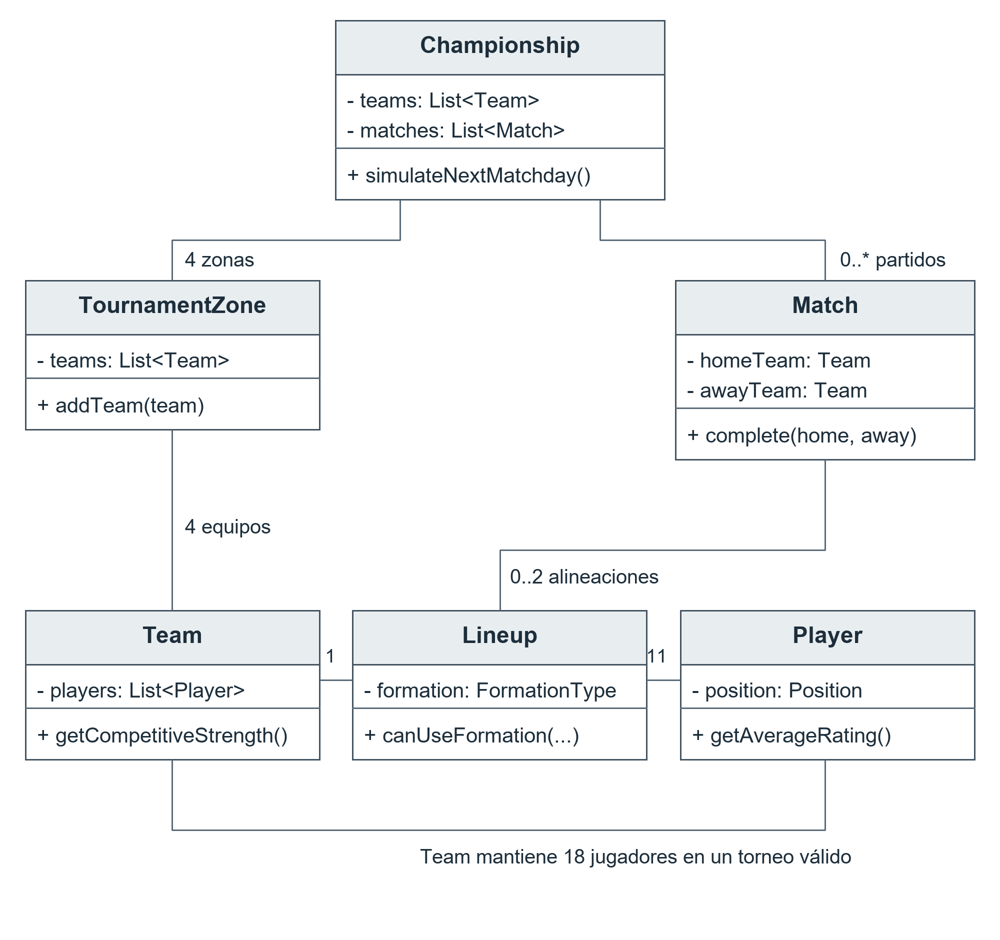
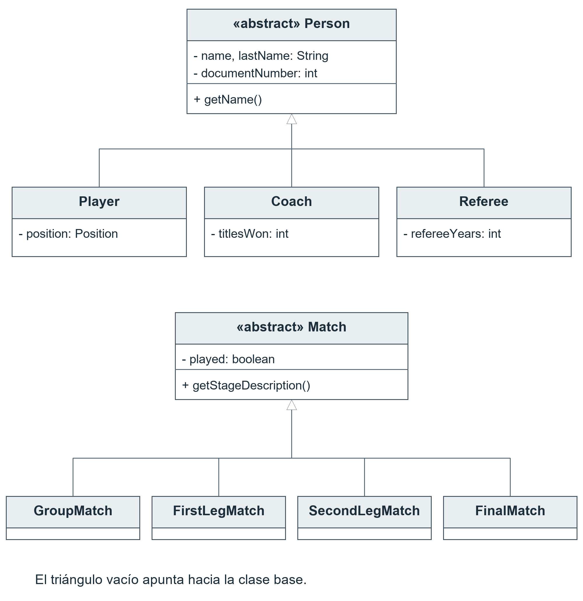
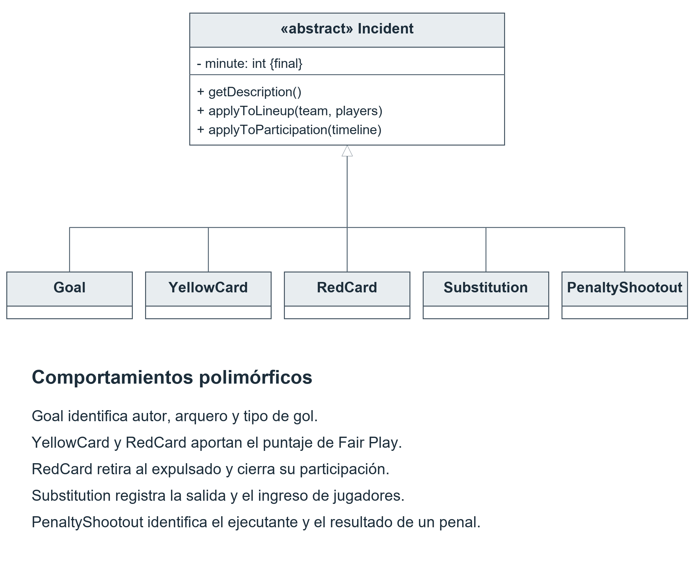
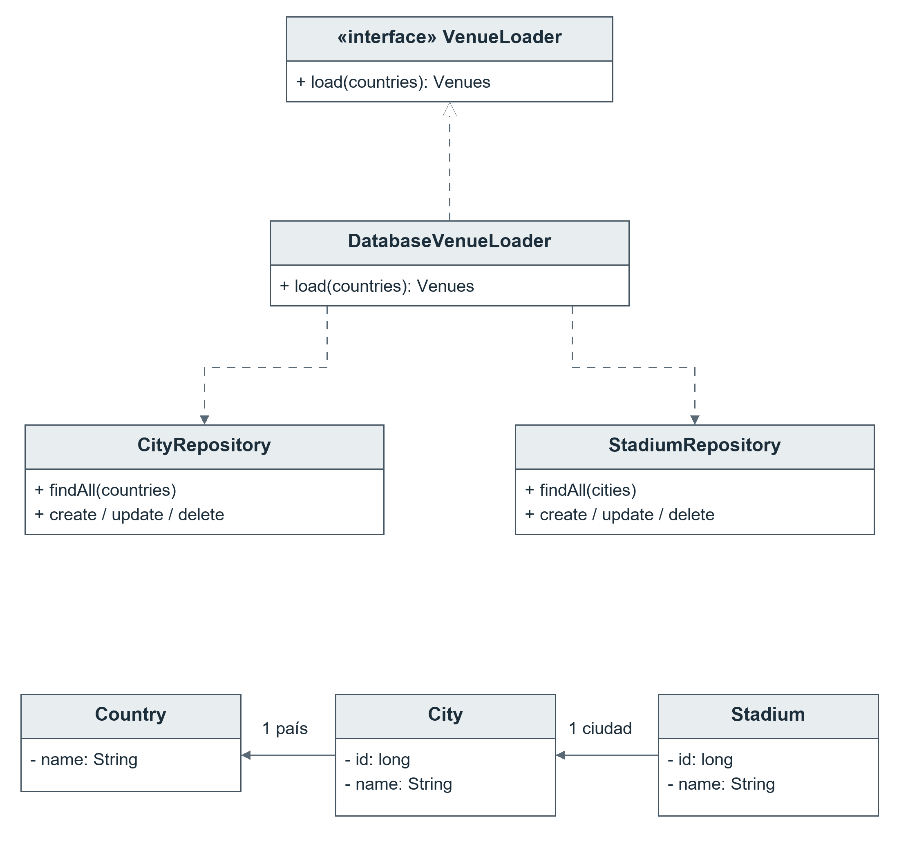
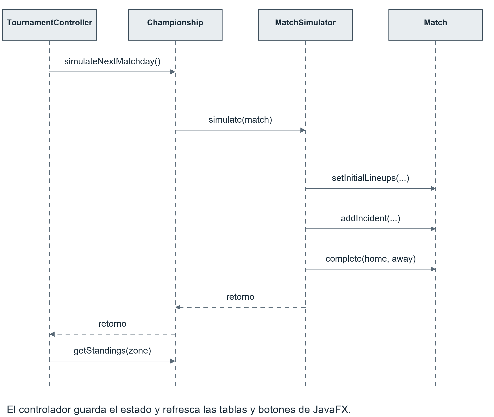

# Documentación técnica del simulador de torneos de fútbol

UFASTA · Universidad FASTA · Programación B

Integrantes: Manuel Gonzalez Sueyro, Mauricio Lobos, Valentin Lobos y Enzo acosta.

Docentes: Luis Buffoni y Claufio Gea.

# Introducción

Organizar un campeonato de fútbol implica mucho más que registrar resultados. Hay que distribuir los equipos en grupos, armar el calendario, asignar árbitros y estadios, controlar las suspensiones y determinar quiénes avanzan en cada etapa. A medida que se disputan los partidos, también es necesario mantener actualizadas las posiciones y las estadísticas de los participantes.

Este trabajo aborda esa problemática mediante una aplicación que permite gestionar y simular un torneo de 16 equipos, desde el sorteo de los grupos hasta la definición del campeón. El usuario puede avanzar por fechas y partidos, consultar lo ocurrido en cada encuentro y retomar el campeonato después de cerrar el programa. La aplicación también permite administrar ciudades y estadios, consultar reportes y generar credenciales de los participantes.

Para resolver estas tareas, el código separa la interfaz gráfica, las reglas del torneo, la simulación y el acceso a los datos. JavaFX ofrece las pantallas de interacción; el dominio representa a los equipos, jugadores y partidos; PostgreSQL conserva las sedes, y el guardado en archivo permite recuperar el desarrollo del campeonato.

En las páginas siguientes se explica cómo se conectan estas partes, qué responsabilidad tiene cada clase y cuáles son los métodos que intervienen en las operaciones principales. Los diagramas UML acompañan la descripción para mostrar las relaciones entre los objetos y el recorrido de una acción dentro del programa.

# 1 Estructura y arquitectura

El proyecto utiliza Maven. El código de producción está en src/**main**/java, las vistas y recursos en src/**main**/resources y las pruebas en src/test/java. torneo.json aporta participantes. pom.xml configura Java 24 y declara Gson 2.10.1, PostgreSQL JDBC 42.7.8, JavaFX 21.0.2 y OpenPDF 2.0.3.

## Paquetes

- GUI: inicio de JavaFX y configuración de la ventana.
- Controller: acciones del usuario, navegación y actualización de pantallas.
- Core.Run: **Championship**, encargado de coordinar el campeonato.
- Core.domain: entidades y objetos de negocio, como **Team**, **Player**, **Match** y **Lineup**.
- Core.incidents: eventos del encuentro y comportamiento específico de cada evento.
- Core.enums: posiciones, formaciones y etapas permitidas.
- Core.dto: estructuras compatibles con las claves del JSON.
- Core.loader: carga, transformación y validación inicial; contrato de carga de sedes.
- Core.scheduling: sorteo equilibrado, calendario y árbitros.
- Core.simulation: marcador, alineaciones, incidentes y tandas.
- Core.classification: posiciones de grupos y resolución de eliminatorias.
- Core.report: estadísticas, formatos de presentación y credenciales PDF.
- Core.persistance: guardado y recuperación; se conserva la escritura real del paquete.
- Infrastructure.database: JDBC, repositorios y carga de sedes desde PostgreSQL.
- Utils: constante de ruta de la pantalla inicial.


## Comunicación entre capas

Las vistas FXML definen controles. Los controladores reciben acciones, llaman al dominio, consultan el resultado y refrescan la vista. **Championship** coordina servicios que operan sobre objetos Java. El dominio no actualiza directamente botones o tablas JavaFX.

La estructura está inspirada en MVC. No es una separación absoluta: **Championship** crea DatabaseVenueLoader como implementación predeterminada y los controladores conocen los servicios y repositorios que necesitan. VenueLoader permite sustituir la fuente de sedes mediante **setVenueLoader**, especialmente en pruebas.

# 2 Inicio y recorrido de una acción

## Creación del campeonato

1. AppLauncher.**main** llama a View.**main**. View.**start** carga MainMenu.fxml, crea la escena y configura la ventana.
2. MainMenuController abre la pantalla NewTournament.fxml.
3. NewTournamentController.**handleCreateTournament** valida el nombre y construye **Championship** con torneo.json.
4. TournamentLoader transforma el JSON en objetos y TournamentValidator revisa los planteles.
5. **Championship** inicializa servicios, sortea cuatro zonas y genera 24 partidos de grupos.
6. El controlador intenta cargar sedes, guarda el estado y abre Tournament.fxml.
7. TournamentController.**setTournament** recibe la instancia de **Championship** y prepara la pantalla.

Si falla la carga de sedes, la creación puede continuar con una advertencia. Las eliminatorias necesitarán posteriormente estadios disponibles. El nombre visible del torneo se mantiene en los controladores: no es un atributo de **Championship** y no debe presentarse como parte garantizada de su estado serializado.

## Simulación desde la interfaz

El botón de fechas ejecuta TournamentController.**handleSimulateMatchday**. **Championship**.**simulateNextMatchday** identifica la menor fecha pendiente y llama a **MatchSimulator**.**simulate** por cada encuentro de esa fecha que no esté jugado. Después, el controlador prepara cuartos si corresponde, guarda el estado y refresca tablas y botones.

```java
championship.simulateNextMatchday();
scheduleQuarterFinalsIfNeeded();
saveTournament();
showGroupStage();
updateSimulationButtons();
```

Este fragmento resume el camino exitoso. La implementación también captura errores y actualiza el texto de la fecha. Consultar un detalle o un ganador registrado no simula nuevos resultados: esa separación evita que abrir repetidamente una pantalla cambie el campeonato.

# 3 Championship y las etapas

**Championship** implementa Serializable y conserva listas de equipos, árbitros, países, ciudades, estadios, zonas y partidos. Mantiene stage, quarterFinalWinners, finalists, champion y pendingPenaltyShootout. Los servicios y Random son transient y se reconstruyen al recuperar un guardado.

## Métodos principales

- **getCurrentMatchday**: menor fecha pendiente, o cero cuando no quedan fechas de grupos.
- **simulateNextMatchday**: simula una fecha. La sobrecarga con Consumer permite una acción después de cada encuentro.
- **simulateGroupStage**: recorre todas las fechas pendientes; sigue disponible aunque la pantalla avance de a una fecha.
- **getStandings**: delega la tabla en StandingsCalculator.
- **scheduleQuarterFinals**: valida la etapa y evita crear cruces duplicados.
- **simulateNextKnockoutMatch**: resuelve el siguiente encuentro o la tanda pendiente y prepara el avance de fase.
- **hasPendingPenaltyShootout** y **getPendingPenaltyShootout**: permiten distinguir partido y tanda en la interfaz.
- **loadVenues**: valida la relación entre ciudades y estadios y reemplaza las listas de sedes en memoria.
- **setVenueLoader**: sustituye la fuente de sedes.
- **getRecordedSeriesWinner** y **getRecordedFinalWinner**: consultan ganadores sin simular.

La secuencia de etapas es GROUP_STAGE, QUARTER_FINALS, SEMI_FINALS, FINAL y FINISHED. Hay 24 partidos de grupos, ocho de cuartos, cuatro de semifinales y una final: 37 partidos en total. Las tandas no aumentan esa cantidad.

Si un partido eliminatorio requiere penales, **Championship** conserva su referencia en pendingPenaltyShootout. El siguiente paso resuelve esa tanda antes de buscar otro partido o estadio. El encuentro ya puede estar jugado mientras la clasificación permanece pendiente.

**readResolve** reconstruye servicios, restaura fechas faltantes de guardados anteriores y contrasta la etapa con los encuentros jugados. Se conserva el historial, pero no la secuencia futura exacta de Random. Existen también métodos para simular fases completas; la interfaz utiliza principalmente el recorrido incremental.

# 4 Participantes formaciones y simulación

## Modelo de participantes

**Person** concentra identidad, nombre, apellido, documento y nacimiento. **Player** agrega posición, camiseta, suspensión y mapas de características y estadísticas. **Coach** agrega nacionalidad y títulos; **Referee** agrega nacionalidad y experiencia. **Team** referencia país, entrenador y plantel.

TournamentValidator exige 16 equipos, árbitros y 18 jugadores por equipo: dos arqueros, seis defensores, cinco mediocampistas y cinco delanteros. **Team**.**addPlayer** rechaza null y evita superar 18. Las estadísticas recibidas del JSON son datos de entrada y no sustituyen los reportes calculados a partir de los partidos.

## Selección de una formación

FormationType define 4-3-3, 4-4-2, 3-5-2 y 4-5-1. **Lineup**.**canUseFormation** cuenta jugadores disponibles por posición. **MatchSimulator** elige al azar entre las formaciones posibles y **Lineup** selecciona los jugadores de mayor valoración para cada cupo.

Tener once jugadores disponibles no garantiza poder formar: hacen falta un arquero y suficientes jugadores en cada posición. **Match**.**setInitialLineups** comprueba once jugadores por equipo, pertenencia al equipo correcto y ausencia de una alineación previamente registrada.

## Fuerza y goles

**Team**.**getCompetitiveStrength** combina 35 % de ranking, 55 % del promedio de características del plantel y 10 % de títulos del entrenador. Son pesos de fuerza, no probabilidades directas de ganar. El promedio considera el plantel y no sólo los titulares.

```java
double rankingScore = Math.max(0, 101 - ranking);
double coachScore = Math.min(100, coach.getTitlesWon() * 5.0);
return rankingScore * 0.35
     + getAveragePlayerRating() * 0.55
     + coachScore * 0.10;
```

**MatchSimulator** agrega tres puntos al local y una sorpresa gaussiana con escala 12. Calcula expectativas de gol según la diferencia de fuerzas, las limita entre 0,25 y 3,5 y usa **sampleGoals**, un muestreo de tipo Poisson limitado a seis goles por equipo.

El marcador se obtiene antes de registrar los incidentes. La simulación no recalcula dinámicamente goles como reacción a una expulsión. Los parámetros de fuerza, localía y azar son decisiones de implementación del algoritmo.

## Incidentes y sanciones

Se planifican tarjetas y hasta tres sustituciones por equipo, estas últimas entre los minutos 55 y 90. Los cambios dependen de suplentes y posiciones compatibles. Los eventos se ordenan por minuto y utilizan jugadores que continúan en cancha. Hay un 10 % de probabilidad de planificar una roja directa por equipo.

Para cada gol se sortea un minuto entre 1 y 90 y un participante disponible. Se evalúa un 12 % de gol de penal y, si no es penal, un 3 % de autogol. **Goal** distingue ambas situaciones. El autogol no se acredita como gol personal al jugador en la tabla de goleadores.

Dos amarillas en el mismo encuentro generan una roja. La roja, directa o por doble amarilla, marca suspensión para el siguiente encuentro. Se conserva el conjunto de suspendidos previos, se excluye de la formación y se cumple la sanción antes de generar nuevas rojas. No existe acumulación persistente de amarillas entre partidos.

## Resultados administrativos y tandas

Si un equipo no puede formar, pierde 0-3. Si ninguno puede formar, un sorteo decide el ganador administrativo por 3-0. No se atribuyen goles ni minutos deportivos ficticios a jugadores. Las sanciones previas se cumplen. El usuario informó que estas reglas adicionales fueron aprobadas por el profesor.

El resultado administrativo cuenta en la serie de ida y vuelta. Si una vuelta administrativa deja la serie igualada, **prepareAdministrativeShootout** intenta formar jugadores para una tanda separada. Si todavía no pueden formar, informa el problema.

**PenaltyShootoutSimulator** ejecuta cinco penales por equipo y luego muerte súbita por pares. Cada ejecución tiene probabilidad de acierto 0,75 y registra un **PenaltyShootout** al minuto 90. Los ejecutantes salen de los jugadores presentes al final. La tanda no modifica el marcador ni el ranking de goleadores.

# 5 Calendario árbitros y clasificación

**TournamentScheduler** ordena equipos por ranking, arma cuatro bombos de cuatro, mezcla cada bombo y asigna uno de cada nivel a cada zona. Los grupos tienen tres fechas y dos partidos por zona en cada fecha. Cuartos enfrenta primero de A con segundo de D, primero de B con segundo de C, primero de C con segundo de A y primero de D con segundo de B. La vuelta invierte local y visitante.

## Árbitros

**chooseEligibleReferee** filtra candidatos y sortea uno. Cuando los equipos son de países diferentes, el árbitro no puede ser de ninguno de ellos. Si los equipos son del mismo país, se admite cualquier nacionalidad. Si no quedan candidatos, se informa un error.

Esta excepción figura en la página 4 de la consigna, apartado Acerca de los Partidos. No se eliminó porque forma parte del requisito. **Country**.**equals** compara nombres sin distinguir mayúsculas y minúsculas.

```java
if (home.getCountry().equals(away.getCountry())) return true;
return !referee.getNationality().equals(home.getCountry())
    && !referee.getNationality().equals(away.getCountry());
```

## Posiciones y desempates

StandingsCalculator considera sólo partidos de grupos jugados entre integrantes de la zona. **TeamStanding**.**registerMatch** acumula partidos, resultados, goles y puntos. La victoria aporta tres puntos, el empate uno y la derrota cero.

El orden principal es puntos, diferencia de gol y goles a favor, de mayor a menor. Si persiste igualdad, se calcula una tabla sólo con los encuentros entre empatados y se repiten esos criterios. Finalmente se utiliza el ranking, con el menor número primero. Clasifican dos por zona.

## Eliminatorias

KnockoutResolver compara puntos de ambos partidos y luego diferencia de goles ponderada, donde los goles de visitante valen doble. Si persiste igualdad, se necesita tanda. En la final, un empate en el único partido requiere penales.

El servicio consulta y no simula: **seriesWinnerBeforePenalties** informa si ya hay ganador y los métodos getRecorded... leen el resultado registrado. **PenaltyShootoutSimulator** ejecuta la tanda cuando **Championship** coordina ese paso.

# 6 Persistencia y acceso a datos

## JSON y DTO

TournamentLoader usa Gson y DTO con SerializedName para leer el formato externo. Construye el dominio, convierte posiciones, transforma fechas dd/MM/yyyy a LocalDate y utiliza un mapa para reutilizar países. Al finalizar llama a TournamentValidator.**requireValid**.

Los DTO tienen campos públicos porque son estructuras de intercambio, sin reglas de simulación. Separarlos permite que las claves de un archivo no condicionen toda la API del dominio. **findDuplicateDocuments** es una operación de diagnóstico adicional: **requireValid** no utiliza automáticamente ese resultado para rechazar documentos duplicados.

## PostgreSQL y JDBC

DatabaseConnection.**connect** carga el controlador PostgreSQL y abre jdbc:postgresql://localhost:5432/**Championship** con usuario postgres. La contraseña se obtiene de CHAMPIONSHIP_DB_PASSWORD.

CityRepository y StadiumRepository implementan **findAll**, **create**, **update** y **delete**. Utilizan consultas parametrizadas y try-with-resources. Los identificadores de sedes son long, compatibles con BIGINT. Las consultas relacionan pais(id, nombre), ciudad(id, nombre, id_pais) y estadio(id, nombre, ciudad).

CityRepository.**delete** comprueba si la ciudad tiene estadios antes de borrarla. La comprobación y eliminación se ejecutan en una transacción, con commit o rollback. VenuesController gestiona formularios, confirmaciones y recarga de datos.

DatabaseVenueLoader implementa VenueLoader y devuelve una instantánea de ambas listas. **Championship** recarga las sedes antes de cada partido eliminatorio y filtra identificadores ya usados. Seleccionar un estadio no borra registros de PostgreSQL. Bajo esta regla se requieren trece estadios distintos para completar las eliminatorias.

**Match**.**setStadium** copia los datos básicos del estadio asignado y rechaza cambios después de jugar. La copia continúa referenciando **City**: no es una copia profunda de todo el grafo geográfico.


## Preparación de la base de datos

El archivo database/setup.sql prepara una instalación nueva: crea las tablas pais, ciudad y estadio, con identificadores BIGINT autogenerados, nombres obligatorios y claves foráneas. La relación de estadio con ciudad impide eliminar una ciudad mientras tenga estadios asociados. Los índices únicos evitan repetir nombres de país, ciudades dentro de un país y estadios dentro de una ciudad, sin distinguir mayúsculas.

El script carga los 15 países presentes en torneo.json y 26 ciudades con sus estadios. Esta cantidad cubre los trece encuentros de eliminatorias que requieren sedes distintas. Toda la preparación se ejecuta en una transacción y puede repetirse sin duplicar los datos de ejemplo.

Para instalarla en otra computadora:

1. Conectarse al servidor PostgreSQL local desde pgAdmin con el usuario postgres.
2. Crear una base llamada **Championship**, respetando la C mayúscula. Si se usa SQL, ejecutar CREATE DATABASE "**Championship**"; por separado y fuera de una transacción.
3. Abrir Query Tool dentro de esa base y ejecutar completo database/setup.sql.
4. Configurar CHAMPIONSHIP_DB_PASSWORD en las variables de entorno de la ejecución Java con la contraseña del usuario postgres. La conexión apunta a localhost, puerto 5432.
5. Iniciar GUI.AppLauncher y comprobar la carga de ciudades y estadios.

El archivo database/README.md incluye las instrucciones y consultas de comprobación. setup.sql está pensado para una base nueva o una estructura compatible: no migra esquemas antiguos. Si existen nombres duplicados, la creación de índices puede fallar y la transacción se revierte; después de un error se debe ejecutar ROLLBACK antes de reintentar. El script no elimina datos. add_venues.sql conserva su función de agregar sedes a una base ya preparada y no necesita ejecutarse después de setup.sql.


## Archivo del campeonato

**ChampionshipRepository**.**save** serializa primero en un temporal y luego reemplaza campeonato.dat mediante movimiento atómico. Si falla, informa una excepción. El código no implementa un mecanismo alternativo si el sistema de archivos no admite ese movimiento.

**load** devuelve el campeonato, o null cuando no existe o no puede leerse. **exists** comprueba la presencia del archivo. La serialización conserva entidades y resultados, no conexiones JDBC. **readResolve** reconstruye servicios transient. Este mecanismo facilita recuperar el grafo actual, pero depende de compatibilidad entre versiones de clases.

# 7 Interfaz y reportes

MainMenu.fxml presenta el inicio, NewTournament.fxml crea el torneo, Tournament.fxml contiene simulación y consultas y Venues.fxml administra sedes. style.css define la apariencia. FXMLLoader crea controles e inyecta referencias y manejadores anotados con FXML.

TournamentController.**setTournament** conecta la pantalla con **Championship**. updateSimulationButtons consulta etapa y tanda pendiente. Los manejadores simulan, consultan reportes o muestran detalles. El guardado también se intenta al cerrar o volver al menú.

La exportación PDF utiliza Task y un hilo de trabajo; el botón se deshabilita hasta terminar o fallar. La simulación ordinaria se invoca desde manejadores JavaFX. No debe afirmarse que todas las operaciones del programa sean asíncronas.

## Estadísticas

TournamentReportService calcula goleadores, participación, Fair Play, equipos, jugadores y árbitros. Usa índices **Player**-**Team** y acumuladores locales a cada consulta, sin caché global persistente. **ParticipationTimeline** registra ingresos y salidas y produce minutos jugados.

**RedCard** y **Substitution** actualizan la participación por polimorfismo. Un ingreso al minuto 90 cuenta como participación con cero minutos. Los resultados administrativos no crean minutos ficticios. Las tandas no suman al ranking de goles.

GroupEvolutionReportService reconstruye tablas antes y después de encuentros de una zona. IncidentFormatter incluye el equipo del participante. MatchDetailsFormatter produce título y detalle del partido. PlayerAttributeFormatter presenta etiquetas en inglés y conserva campos adicionales del JSON.

## Credenciales PDF

IdentificationPdfService.**generate** recibe equipos, árbitros, título, carpeta de fotos y destino. Genera credenciales con datos, rol, imagen y código CODE128, hasta tres por página A4. Las fotos se buscan por número de documento y extensión jpg, jpeg o png.

Cuando falta una foto o está dañada, utiliza una de cuatro ilustraciones según el documento y registra la ausencia. Si tampoco se puede cargar la ilustración, conserva un texto de imagen no disponible. El resultado incluye cantidad de credenciales y fotografías faltantes.

Un mapa local a la exportación reutiliza objetos Image, evitando incrustar cientos de copias de los mismos avatares. El PDF activa compresión, se cierra en un temporal y después se mueve al destino. En la prueba verificada se obtuvieron 323 credenciales, 108 páginas y aproximadamente 1,8 MB, frente a unos 125 MB del archivo anterior. La lectura se comprobó con OpenPDF y pypdf.

# 8 Decisiones de diseño y principios de POO

## Herencia y abstracción

**Person**, **Match** e **Incident** concentran datos comunes y contratos. Sus subclases expresan relaciones de tipo es un. **Team** que contiene jugadores y **Match** que referencia una sede son asociaciones, no herencia. **Country** permite comparar países como objetos y reutilizarlos al cargar datos.

## Polimorfismo

**Match** define **getStageDescription** y consultas de etapa. **Incident** define **getDescription**, **applyToLineup**, **applyToParticipation** y consultas relacionadas con goles, tarjetas o tandas. Cada objeto responde según su tipo concreto.

```java
for (Incident incident : incidents) {
    if (incident.getMinute() > minute) break;
    incident.applyToLineup(team, playersOnField);
}
```

**RedCard** quita al expulsado de la copia de jugadores en cancha. **Substitution** retira a uno y agrega al reemplazante. **Goal** hereda la operación sin cambios para esta reconstrucción. Los consumidores no necesitan una cadena de instanceof para ejecutar estos efectos.

VenueLoader agrega polimorfismo por interfaz: PostgreSQL es una implementación, y una prueba puede entregar sedes en memoria. Los métodos **asFirstLeg**, **asSecondLeg** y **asFinal** reducen conversiones externas, aunque conservan conocimiento de las variantes del partido. El diseño no elimina todos los condicionales.

## Encapsulamiento

**Championship**, **Team** y **Lineup** exponen listas no modificables. **Match**.**complete** valida ambos goles antes de cerrar el partido. No se permite reabrir un encuentro resuelto ni reemplazar sus alineaciones iniciales. **Incident** fija el minuto durante la construcción.

La protección no es completa: varias entidades conservan setters públicos y **Player** devuelve mapas modificables. Una lista no modificable no vuelve inmutables a sus elementos. La documentación distingue estas limitaciones de las invariantes que sí se controlan.

## Separación de responsabilidades y eficiencia

El calendario pertenece a **TournamentScheduler**; la simulación a **MatchSimulator**; la evaluación de series a KnockoutResolver; el acceso SQL a repositorios y los reportes a servicios específicos. **Championship** mantiene coordinación y estado, sin concentrar todos los algoritmos.

Los índices de pertenencia y acumuladores evitan recorrer todos los partidos por cada jugador. La caché de imágenes vive sólo durante la exportación. Las tablas y alineaciones todavía se recalculan mediante recorridos de colecciones. El volumen está acotado a 16 equipos y 37 partidos; no se presentan mediciones de velocidad que no hayan sido realizadas.

# 9 Diagramas UML

Las vistas siguientes muestran relaciones relevantes, sin repetir todos los accesores. Un signo menos representa atributo privado y un signo más operación pública. Las líneas continuas representan asociaciones. El triángulo vacío apunta a la clase base; con línea discontinua indica realización de una interfaz. Una flecha discontinua simple representa dependencia.


## UML del núcleo del dominio



**Championship** conserva zonas y partidos. Una zona reúne equipos, **Team** mantiene su plantel y **Lineup** selecciona once jugadores. **Match** tiene una alineación por equipo cuando se disputa el encuentro; en un resultado administrativo pueden faltar. Esta vista omite árbitro y sede para mantener legibilidad.

## UML de herencia



Las clases abstractas reúnen lo común. **Player**, **Coach** y **Referee** agregan datos de su rol. Los tipos de **Match** especializan grupos, ida, vuelta y final. El triángulo apunta a la superclase.

## UML de incidentes



La reconstrucción de alineaciones y los reportes utilizan **Incident** y delegan el comportamiento a cada evento concreto. Cada método responde sólo con la información o efecto que corresponde a ese evento.

## UML de sedes y servicios



DatabaseVenueLoader implementa VenueLoader y depende de los dos repositorios. **Stadium** referencia **City** y **City** referencia **Country**. DatabaseConnection administra la apertura de conexiones SQL.

## UML de secuencia



El diagrama resume la simulación de una fecha. La llamada a **MatchSimulator** se repite para cada encuentro pendiente. Al volver, el controlador guarda el estado, consulta posiciones y refresca JavaFX. Los retornos no representan llamadas del dominio a la vista.

# 10 Catálogo de clases y métodos

El catálogo cubre los archivos Java de producción presentes en la revisión. Las rutas son relativas a la raíz del proyecto. Los accesores simples getX y setX se agrupan: leen o escriben el atributo X. Los métodos destacados expresan comportamiento o consulta relevante. Las firmas completas públicas están disponibles en inventario_clases.json.

## Paquete GUI

### AppLauncher

Ubicación: src/main/java/GUI/AppLauncher.java

Punto de entrada de escritorio. **main** delega en View para iniciar JavaFX.

### View

Ubicación: src/main/java/GUI/View.java

Extiende Application. **start** carga el menú, crea la escena y configura la ventana; **main** inicia el ciclo de JavaFX.

## Paquete Controller

### MainMenuController

Ubicación: src/main/java/Controller/MainMenuController.java

Recibe las acciones del menú. **handleNewTournament** abre la creación, **handleLoadTournament** recupera el archivo y prepara la pantalla, y **handleExit** cierra la aplicación.

### NewTournamentController

Ubicación: src/main/java/Controller/NewTournamentController.java

Valida el nombre y crea **Championship**. **loadVenues** intenta incorporar sedes, openTournament carga el FXML y entrega el dominio al nuevo controlador.

### StadiumController

Ubicación: src/main/java/Controller/StadiumController.java

Clase vacía en la versión revisada. No tiene comportamiento ni participa del flujo de administración actual, que corresponde a VenuesController.

### TournamentController

Ubicación: src/main/java/Controller/TournamentController.java

Coordina la pantalla del torneo. **handleSimulateMatchday** y **handleSimulateKnockoutMatch** ejecutan pasos; **showZone** y **buildKnockoutBracket** presentan resultados. Los manejadores de estadísticas llaman a servicios y **handleGetIdentifications** prepara la exportación en segundo plano. **setTournament** conecta la instancia del dominio y **saveTournament** conserva el estado.

### VenuesController

Ubicación: src/main/java/Controller/VenuesController.java

Administra ciudades y estadios. Los manejadores **handleAdd**..., **handleUpdate**... y **handleDelete**... validan formularios y llaman a repositorios; refreshData recarga listas y **setTournament** conserva el contexto al navegar.

## Paquete Core.Run

### Championship

Ubicación: src/main/java/Core/Run/Championship.java

Estado y coordinación del campeonato. Mantiene colecciones, etapa, clasificados, campeón y tanda pendiente. Delega calendario, simulación y clasificación. **readResolve** reconstruye servicios al recuperar un archivo.

## Paquete Core.domain

### City

Ubicación: src/main/java/Core/domain/City.java

Entidad de ciudad con id long, nombre y referencia a **Country**. Sus accesores permiten consulta y edición; **toString** facilita la presentación en controles.

### Coach

Ubicación: src/main/java/Core/domain/Coach.java

Especialización de **Person** con nacionalidad y títulos ganados. **getTitlesWon** aporta el dato que **Team** transforma en parte de su fuerza competitiva.

### Country

Ubicación: src/main/java/Core/domain/Country.java

Objeto de país identificado por su nombre. **setName** rechaza texto vacío y elimina espacios extremos. **equals** y **hashCode** comparan sin distinguir mayúsculas; **toString** devuelve el nombre.

### FinalMatch

Ubicación: src/main/java/Core/domain/FinalMatch.java

Representa la final única. Especializa descripción, **asFinal** y el indicador de resolución por penales.

### FirstLegMatch

Ubicación: src/main/java/Core/domain/FirstLegMatch.java

Representa la ida de una serie. Especializa la descripción y **asFirstLeg** retorna la instancia para consultas sobre cruces.

### GroupMatch

Ubicación: src/main/java/Core/domain/GroupMatch.java

Especializa **Match** con número de fecha. **getStageDescription** **describe** la etapa, **isGroupStage** devuelve verdadero y **getMatchday** y **setMatchday** administran la fecha de grupos.

### Lineup

Ubicación: src/main/java/Core/domain/Lineup.java

Selección concreta de titulares para una formación. **canUseFormation** comprueba disponibilidad por posición; selectBestLineup elige mejores valoraciones; **getGoalkeeper** y **getOutfieldPlayers** separan roles. **getPlayers** devuelve una lista no modificable.

### Match

Ubicación: src/main/java/Core/domain/Match.java

Base abstracta del encuentro. Conserva participantes, árbitro, fecha, sede, resultado, alineaciones e incidentes. **addIncident** ordena por minuto; **getPlayersOnField** reconstruye una copia de la alineación; **complete** valida y cierra; **awardForfeit** y **awardRandomForfeit** registran resoluciones administrativas.

### ParticipationTimeline

Ubicación: src/main/java/Core/domain/ParticipationTimeline.java

Cálculo temporal sin modificar jugadores. **enter** registra ingreso, **leave** salida y **minutesPlayed** produce minutos por jugador; el ingreso al minuto 90 conserva participación con cero minutos.

### Person

Ubicación: src/main/java/Core/domain/Person.java

Base abstracta de participantes. Valida nombre, apellido, documento y nacimiento en el constructor. Los accesores exponen los datos comunes y varias propiedades mantienen setters.

### Player

Ubicación: src/main/java/Core/domain/Player.java

Especialización de **Person** con camiseta, posición, suspensión, características y estadísticas. **getAverageRating** promedia características y **serveSuspensionIfNeeded** cumple una sanción pendiente.

### Referee

Ubicación: src/main/java/Core/domain/Referee.java

Especialización de **Person** con nacionalidad y experiencia. Los datos sirven para elegibilidad y reportes de árbitros.

### SecondLegMatch

Ubicación: src/main/java/Core/domain/SecondLegMatch.java

Representa la vuelta y conserva datos del resultado de ida y la resolución por penales. **asSecondLeg** permite consultar esa variante y **isSettledByPenalties** informa el modo de definición.

### Stadium

Ubicación: src/main/java/Core/domain/Stadium.java

Entidad de estadio con id long, nombre y referencia a **City**. Su país se obtiene a través de la ciudad. **toString** prepara una etiqueta legible.

### Team

Ubicación: src/main/java/Core/domain/Team.java

Contiene identidad, nombre, país, ranking, entrenador y plantel. **addPlayer** controla nulos y límite de 18; **getAveragePlayerRating** y **getCompetitiveStrength** calculan fuerza; **getPlayers** protege la lista.

### TeamStanding

Ubicación: src/main/java/Core/domain/TeamStanding.java

Acumulador de posiciones de un equipo. **registerMatch** actualiza puntos, partidos, resultados y goles. **getGoalDifference** calcula goles a favor menos goles en contra.

### TournamentZone

Ubicación: src/main/java/Core/domain/TournamentZone.java

Agrupa equipos de una zona. **addTeam** incorpora integrantes y sus consultas permiten obtener nombre y equipos para calendario y clasificación.

## Paquete Core.incidents

### Goal

Ubicación: src/main/java/Core/incidents/Goal.java

Registra autor, arquero, penal y autogol. **getScoringPlayer** devuelve null para autogoles, evitando acreditarlos al ranking personal. **isMatchGoal** e **isPenaltyGoal** distinguen la contabilización.

### Incident

Ubicación: src/main/java/Core/incidents/Incident.java

Base abstracta de eventos con minuto final. Define descripción y métodos polimórficos para alineación, participación y consultas de reportes. Las respuestas neutras por defecto permiten que cada subclase redefina lo pertinente.

### PenaltyShootout

Ubicación: src/main/java/Core/incidents/PenaltyShootout.java

Representa un lanzamiento de tanda, su ejecutante y conversión. **isShootoutPenalty**, **getPenaltyTaker** e **isPenaltyScored** permiten resolver el ganador sin confundirlo con goles del partido.

### RedCard

Ubicación: src/main/java/Core/incidents/RedCard.java

Registra al expulsado. **applyToLineup** lo quita de la copia de jugadores, **applyToParticipation** cierra sus minutos y **getFairPlayPoints** aporta la penalización de la roja.

### Substitution

Ubicación: src/main/java/Core/incidents/Substitution.java

Registra jugador saliente y entrante. **applyToLineup** reemplaza al jugador; **applyToParticipation** registra los dos instantes. **getParticipant** utiliza al entrante para identificar el equipo al mostrar el evento.

### YellowCard

Ubicación: src/main/java/Core/incidents/YellowCard.java

Registra al amonestado. Identifica tarjeta amarilla y aporta su puntaje de Fair Play. No expulsa por sí sola; el simulador determina cuándo una segunda amarilla genera **RedCard**.

## Paquete Core.enums

### FormationType

Ubicación: src/main/java/Core/enums/FormationType.java

Enum de esquemas 4-3-3, 4-4-2, 3-5-2 y 4-5-1. Conserva cantidades de defensores, mediocampistas y delanteros; los getters exponen esos cupos.

### Position

Ubicación: src/main/java/Core/enums/Position.java

Enum de posiciones admitidas: arquero, defensor, mediocampista y delantero. Se utiliza para validar planteles, elegir titulares y filtrar estadísticas.

### TournamentStage

Ubicación: src/main/java/Core/enums/TournamentStage.java

Enum de las etapas GROUP_STAGE, QUARTER_FINALS, SEMI_FINALS, FINAL y FINISHED. El coordinador y la interfaz lo usan para controlar avance y acciones disponibles.

## Paquete Core.loader

### TournamentData

Ubicación: src/main/java/Core/loader/TournamentData.java

Resultado de carga con equipos, árbitros y países. Es el objeto de intercambio entre loader, validador y **Championship**.

### TournamentLoader

Ubicación: src/main/java/Core/loader/TournamentLoader.java

**load** lee el archivo, deserializa con Gson, transforma DTO a dominio y valida. mapTeams, mapReferees, mapPlayer y mapCoach construyen entidades; parseDate y mapPosition convierten formatos; countryFor reutiliza países.

### TournamentValidator

Ubicación: src/main/java/Core/loader/TournamentValidator.java

**validate** produce errores de estructura y plantel; **requireValid** lanza una excepción si hay errores. **findDuplicateDocuments** proporciona un diagnóstico separado de documentos repetidos.

### VenueLoader

Ubicación: src/main/java/Core/loader/VenueLoader.java

Interfaz funcional con **load**(countries). Su record Venues contiene listas copiadas de ciudades y estadios. Permite sustituir PostgreSQL por una fuente de pruebas.

Operación del contrato: **load**(List<**Country**>). El record Venues expone cities() y stadiums().

## Paquete Core.dto

### CoachDto

Ubicación: src/main/java/Core/dto/CoachDto.java

Datos externos del entrenador, incluidos datos personales, nacionalidad y títulos. Se transforma en **Coach**.

Campos de intercambio: person (PersonDto), country (**CountryDto**), titlesWon (int).

### CountryDto

Ubicación: src/main/java/Core/dto/CountryDto.java

Representación de país utilizada por el adaptador Gson. Permite transformar el valor externo en **Country** reutilizado por nombre.

Campos de intercambio: name (String).

### PersonDto

Ubicación: src/main/java/Core/dto/PersonDto.java

Datos de identificación externos: tipo y número de documento, nombre completo y fecha como texto. TournamentLoader los convierte al modelo.

Campos de intercambio: documentType (String), documentNumber (int), fullName (String), birthDate (String).

### PlayerDto

Ubicación: src/main/java/Core/dto/PlayerDto.java

Datos externos de posición, persona, características y estadísticas. Compone PersonDto; no hereda de **Person** del dominio.

Campos de intercambio: position (String), person (PersonDto), characteristics (Map<String, Integer>), statistics (Map<String, Integer>).

### PlayersDto

Ubicación: src/main/java/Core/dto/PlayersDto.java

Envoltorio de la lista de PlayerDto correspondiente a los jugadores del JSON.

Campos de intercambio: player (List<PlayerDto>).

### RefereeDto

Ubicación: src/main/java/Core/dto/RefereeDto.java

Datos externos del árbitro, incluidos persona, nacionalidad y experiencia. Se transforma en **Referee**.

Campos de intercambio: person (PersonDto), country (**CountryDto**), refereeYears (int).

### RefereesDto

Ubicación: src/main/java/Core/dto/RefereesDto.java

Envoltorio de la lista de RefereeDto del archivo.

Campos de intercambio: referee (List<RefereeDto>).

### SquadDto

Ubicación: src/main/java/Core/dto/SquadDto.java

Agrupa al entrenador y al contenedor de jugadores del plantel recibido.

Campos de intercambio: players (PlayersDto), coach (CoachDto).

### TeamDto

Ubicación: src/main/java/Core/dto/TeamDto.java

Datos externos de un equipo: nombre, país, ranking y plantel. El cargador los convierte en **Team**, **Coach** y **Player**.

Campos de intercambio: name (String), country (**CountryDto**), ranking (int), squad (SquadDto).

### TeamsDto

Ubicación: src/main/java/Core/dto/TeamsDto.java

Envoltorio de la lista de TeamDto tal como aparece en el archivo externo.

Campos de intercambio: team (List<TeamDto>).

### TournamentDto

Ubicación: src/main/java/Core/dto/TournamentDto.java

Agrupa las estructuras teams y referees, mapeadas desde equipos y arbitros.

Campos de intercambio: teams (TeamsDto), referees (RefereesDto).

### TournamentRootDto

Ubicación: src/main/java/Core/dto/TournamentRootDto.java

Nodo raíz del JSON. El campo tournament corresponde a la clave torneo y contiene TournamentDto.

Campos de intercambio: tournament (TournamentDto).

## Paquete Core.scheduling

### TournamentScheduler

Ubicación: src/main/java/Core/scheduling/TournamentScheduler.java

Ordena y sortea zonas equilibradas, construye fechas y cruces y asigna árbitros elegibles. Devuelve calendarios al coordinador sin ejecutar partidos.

## Paquete Core.simulation

### MatchSimulator

Ubicación: src/main/java/Core/simulation/MatchSimulator.java

**simulate** selecciona formaciones, resuelve disponibilidad, calcula marcador, genera incidentes y cierra el encuentro. **chooseRandomFormation** filtra esquemas y **sampleGoals** muestrea goles. **prepareAdministrativeShootout** habilita una tanda luego de una resolución administrativa.

### PenaltyShootoutSimulator

Ubicación: src/main/java/Core/simulation/PenaltyShootoutSimulator.java

**simulate** obtiene jugadores presentes al final y ejecuta cinco lanzamientos más muerte súbita si hace falta. simulatePenalty usa probabilidad 0,75 y agrega cada **PenaltyShootout** al encuentro.

## Paquete Core.classification

### KnockoutResolver

Ubicación: src/main/java/Core/classification/KnockoutResolver.java

Servicio de consulta para series y final. **getSeriesPoints** y **getWeightedGoalDifference** aplican criterios; **seriesWinnerBeforePenalties** informa si falta tanda; **recordedPenaltyWinner** cuenta los penales ya registrados. No sortea resultados al consultar.

### StandingsCalculator

Ubicación: src/main/java/Core/classification/StandingsCalculator.java

**calculate** genera posiciones por zona desde partidos jugados. **buildTable** acumula resultados y resolveTie arma la tabla entre empatados antes del criterio final de ranking.

## Paquete Core.persistance

### ChampionshipRepository

Ubicación: src/main/java/Core/persistance/ChampionshipRepository.java

Serializa el campeonato en un temporal y reemplaza el destino de forma atómica. **save** informa errores, **load** recupera o devuelve null y **exists** comprueba el archivo. Permite ruta predeterminada o ruta recibida en constructor.

## Paquete Infrastructure.database

### CityRepository

Ubicación: src/main/java/Infrastructure/database/CityRepository.java

Acceso SQL a ciudades. **findAll** relaciona países con el catálogo de objetos; **create** inserta y recupera id; **update** modifica; **delete** rechaza ciudades con estadios y maneja transacción.

### CityRepositoryTest

Ubicación: src/main/java/Infrastructure/database/CityRepositoryTest.java

Ejecutable manual de comprobación del repositorio de ciudades. Requiere base configurada; revisar las operaciones antes de ejecutarlo.

### DatabaseConnection

Ubicación: src/main/java/Infrastructure/database/DatabaseConnection.java

Utilidad final sin instancias. **connect** obtiene contraseña del entorno, carga el driver y abre la conexión JDBC.

### DatabaseTest

Ubicación: src/main/java/Infrastructure/database/DatabaseTest.java

Ejecutable manual para comprobar la conexión PostgreSQL. No forma parte del recorrido normal de JavaFX.

### DatabaseVenueLoader

Ubicación: src/main/java/Infrastructure/database/DatabaseVenueLoader.java

Implementación de VenueLoader que consulta CityRepository y después StadiumRepository y entrega ambas listas de sedes.

### StadiumRepository

Ubicación: src/main/java/Infrastructure/database/StadiumRepository.java

Acceso SQL a estadios. **findAll** relaciona cada estadio con una ciudad conocida y **create**, **update** y **delete** implementan ABM mediante parámetros.

### StadiumRepositoryTest

Ubicación: src/main/java/Infrastructure/database/StadiumRepositoryTest.java

Ejecutable manual de comprobación del repositorio de estadios. Requiere base configurada; revisar las operaciones antes de ejecutarlo.

## Paquete Core.report

### GroupEvolutionReportService

Ubicación: src/main/java/Core/report/GroupEvolutionReportService.java

**buildReport** ordena encuentros por fecha, reconstruye tablas antes y después de los resultados y genera un informe textual de evolución de la zona.

### IdentificationPdfService

Ubicación: src/main/java/Core/report/IdentificationPdfService.java

**generate** produce credenciales y devuelve **Result**(total, missingPhotos). Participant organiza persona, rol y detalles. **findPhoto** elige fotografía o avatar y reutiliza imágenes; cell crea celdas con formato. El servicio no depende de JavaFX.

**Result** expone total() y missingPhotos(). Participant es un record privado de apoyo a la exportación.

### IncidentFormatter

Ubicación: src/main/java/Core/report/IncidentFormatter.java

**describe** combina la descripción del evento y el equipo de su participante. Centraliza el texto utilizado por la interfaz.

### MatchDetailsFormatter

Ubicación: src/main/java/Core/report/MatchDetailsFormatter.java

**title** identifica el encuentro y **format** presenta resultado, contexto, alineaciones e incidentes existentes. Las consultas no vuelven a simular.

### PlayerAttributeFormatter

Ubicación: src/main/java/Core/report/PlayerAttributeFormatter.java

**format** presenta mapas de atributos con etiquetas conocidas en inglés y conserva claves adicionales del archivo de entrada.

### TournamentReportService

Ubicación: src/main/java/Core/report/TournamentReportService.java

Produce filas de goleadores, participación, Fair Play, equipos, jugadores y árbitros. indexTeams construye pertenencia y **collectPlayerTotals** acumula estadísticas por solicitud. Sus clases internas Row contienen los datos que consume la interfaz.

Tipos internos de salida: **TopScorerRow**, **ParticipationRow**, **FairPlayRow**, **TeamStatsRow**, **PlayerStatsRow** y **RefereeStatsRow**. Sus getters exponen los datos de cada fila. PlayerTotals es un acumulador privado temporal.

## Paquete Utils

### Paths

Ubicación: src/main/java/Utils/Paths.java

Contiene GESTIONAR_INITIAL_MENU_VIEW con la ruta del menú. Es una utilidad mínima y no coordina la navegación actual.


# 11 Pruebas y verificación

Las pruebas actuales son clases ejecutables mediante **main**. No se debe asumir que mvn test las ejecuta como una batería JUnit: pom.xml no declara JUnit. Los auxiliares de Infrastructure.database requieren revisar la base y la operación que realizan antes de ejecutarlos.

- ChampionshipTest: construcción y simulación general.
- StagedSimulationTest: avance por fechas, eliminatorias, tandas y recuperación serializada.
- StandingsTieBreakerTest: orden de posiciones y desempates.
- StadiumAvailabilityTest: selección y seguimiento de sedes utilizadas.
- UnavailablePlayersTest: planteles impedidos y resultados administrativos.
- PlayerReportsTest: estadísticas y participación comparadas con los eventos.
- ReportAndSaveTest: reportes y escenarios de guardado.
- IdentificationPdfServiceTest: lectura de credenciales y reutilización de avatares.
